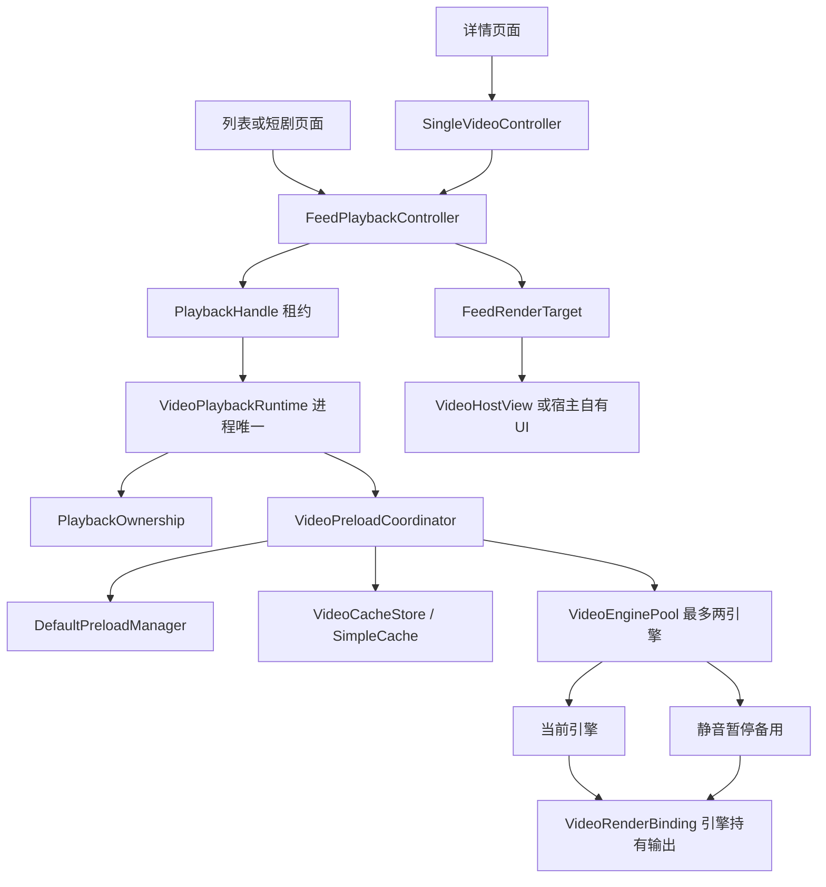

# 架构与类

## 模块边界

- `player`：播放、会话、资源所有权、缓存、预加载与渲染协议；不依赖 RecyclerView、ViewPager2 或 SavedStateRegistry。
- `player-ui`：可选的 `VideoFeedBinding` 与 `VideoViewHolder`，依赖核心和 AndroidX 容器，自动管理选播、宿主、监听、生命周期及状态序列化。通过扩展函数 `bindVideoFeed` 创建；底层控制器继续公开。
- `sample`：业务界面示例，只配置 Adapter、媒体数据与绑定入口。进程级初始化统一在 SampleApplication 执行。

相同 View 重复绑定会立即报错；关闭会移除全部监听和保存状态提供器。数据变更使旧宿主失效，重新按已附着 Holder 的实际位置绑定；列表选播规则可独立单元测试。

## 控制协议与 UI

`PlaybackController` 是页面和控件的共同命令入口，`PlaybackState` 描述当前媒体及能力，`PlaybackStateStore` 处理立即订阅、去重、重入顺序和终态清理。`FeedPlaybackController` 仍负责场景仲裁，`SingleVideoController` 复用同一实现；引擎事件经当前有效句柄回传，防止旧媒体污染当前状态。

`PlayerControlView` 只订阅协议并发送命令。`FullScreenCoordinator` 只处理视图迁移、窗口和归还，不创建播放资源。详见[控制层接入](playback-controls.md)。

## 资源和所有权

Controller与页面一一对应，Runtime与进程一一对应。详情页抢占时先更换租约归属，再撤销旧句柄，因此旧页面迟到的pause/seek/close无法回收新页面资源。自动播放不能抢走已有浮窗租约；用户明确播放可发起抢占。Runtime提供渲染租约转交，不负责创建系统悬浮窗或申请权限。

## 稳定接入面

| 类/接口 | 边界 |
| --- | --- |
| VideoMedia | 宿主映射后的媒体ID、URL、直播标记、初始位置与可播放标记；不接收业务响应对象 |
| PlayerConfiguration | 缓存目录/容量、DataSource工厂、codec选择、自动播放策略、授权与统计接入 |
| VideoPlaybackRuntime | 主线程初始化、全局资源归属、其他音视频打断、浮窗转交和应用级shutdown |
| FeedPlaybackController | 列表选中/滚动/可见性、渲染宿主注册、恢复状态、前后预加载及预热方向 |
| SingleVideoController | 对单项Feed的薄适配，与列表共用Runtime |
| PlaybackHandle | 命令入口和失效保护；页面不直接控制ExoPlayer |
| PlaybackRenderTarget / FeedRenderTarget | 渲染与预热租约协议，核心不依赖具体业务View |
| VideoHostView / PlayerRendering | 可选基础播放器UI或自有PlayerView的绑定工具 |
| PlaybackPolicy | 主线程授权与网络弹窗的应用接口；SDK不提供支付、账号或业务弹窗 |
| PlaybackAnalytics | 正式会话统计初态及Media3 listener适配；预热不会建立正式统计会话 |
| PlaybackEvents / PlaybackMetrics | 首帧、错误、可听播放开始/停止等应用级事件 |
| FeedPlaybackState / PlaybackSessionSnapshot | 可序列化的值快照，不持有Context、View、Player或URL |

## 内部实现

| 类 | 职责 |
| --- | --- |
| PlaybackOwnership | 所有权先行的租约仲裁 |
| PlaybackSession / PlaybackAttempt / PlaybackStartupTrace | 进度与用户意图、唯一终态、选中到首帧计量 |
| VideoPreloadCoordinator / PreloadProgress | 对称窗口、精确起点、完成状态、取消代次与回退 |
| VideoEnginePool | 当前/备用角色切换，资源降级及内存回调 |
| WarmupSeekBoost | 500ms codec软截止、1500ms调度硬截止与全部退出清理 |
| VideoLoadControl / WarmupBufferBudget | 当前播放器原缓冲策略及备用1秒/2MiB读取判断阈值 |
| VideoRenderBinding | 稳定TextureView/Surface、展示Player代理、跨宿主租约与释放栅栏 |
| VideoCacheStore | 单进程唯一SimpleCache实例和目录锁；不是额外下载器 |
| VideoReadStatistics / VideoReadRegistry | 有界匿名计量，最近16项媒体与每项24条请求 |
| VideoReadDataSource / VideoReadMediaSourceFactory | 透明读取与取消观测，保持响应头、异常、缓存策略 |
| MediaAudioFocusManager / VideoAudioFocusRegistry | 平台焦点适配，业务全局音频协调改为宿主事件接口 |

## 状态与约束

预加载先让两侧达到起播目标，再补相邻缓冲；备用解码器只接受完成的source。未命中撤销旧登记再准备普通source，使用同一磁盘缓存。取消在途预热会撤销旧sample代次，延后按最新窗口重建，不复用已释放period的ready状态。

Surface归引擎，宿主负责封面和基础控件。预热时始终静音暂停；首次实际显示后才撤下封面。拖动开始仅改变备用提示，正式选中才交接，IDLE才启动新项。暂停按钮在滚动期间被抑制，持续BUFFERING达到300ms才显示基础加载指示。

首帧可先于READY；统计器用实际Player状态初始化，不能伪造READY。选中到首帧可以包含已预渲染帧的可展示耗时，不能冒充重新解码耗时。读取是应用层read返回量，不是线上字节、唯一缓存区间或纯网络等待；回调快照不代表硬件出帧瞬间。

当前框架明确绑定已验证的Media3实现，没有引入空泛的IPlayerEngine或声称支持其他播放器内核。厂商兼容选择器通过配置注入，原工程MIUI相关判断不硬编码在通用库中。

## 常量约定

跨组件使用的诊断协议值按语义定义在 `PlaybackDiagnosticValues.kt`，包括播放结束结果、等待原因、预热/预加载原因、读取来源与加载事件。它们仅在模块内部可见，保留原有字符串值，便于现有日志消费者继续使用。

单组件的阈值、容量和内部名称保留为所属组件的私有常量，名称携带单位（如 `_MS`、`_MB`、`_BYTES`）；Android API 版本使用平台 `Build.VERSION_CODES`。默认磁盘缓存容量通过 `PlayerConfiguration.DEFAULT_CACHE_BYTES` 命名。

UI 接入层的状态保存字段统一在 `PlaybackStateKeys` 中定义。修改字段名称时必须兼顾旧版本 Bundle 的恢复，不随代码重命名改变持久化键值。数学运算中的零、一和空值仍直接表达，不为消除所有字面量创建无意义的常量。
